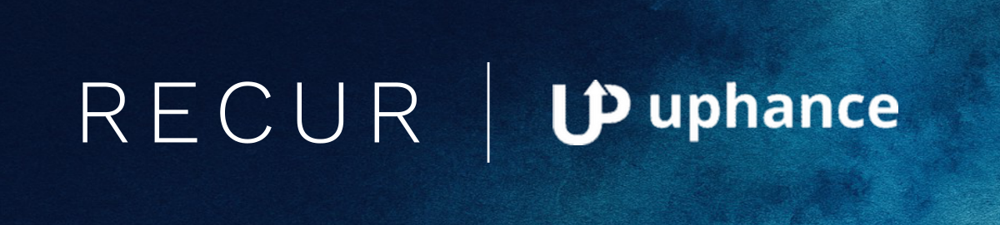
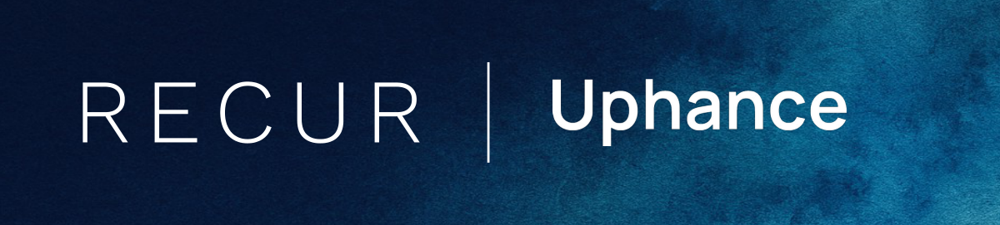
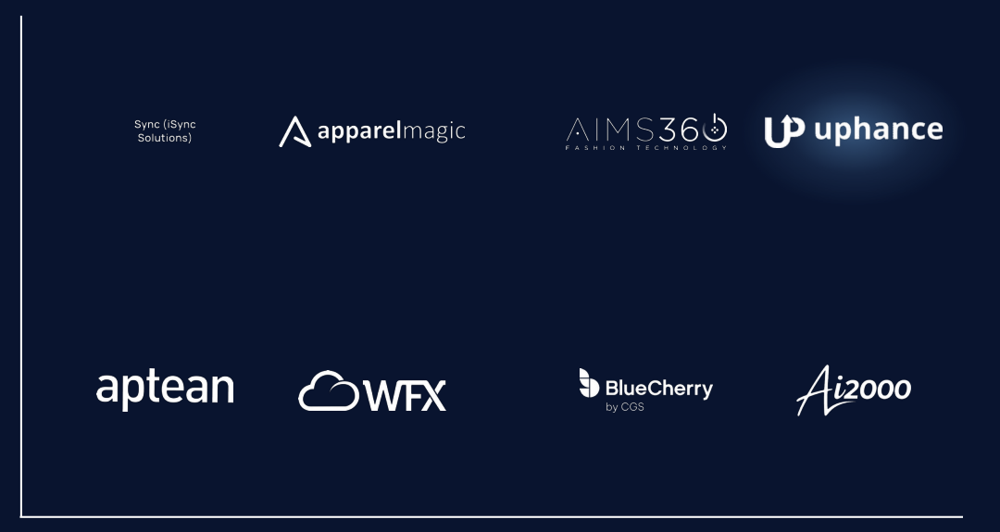
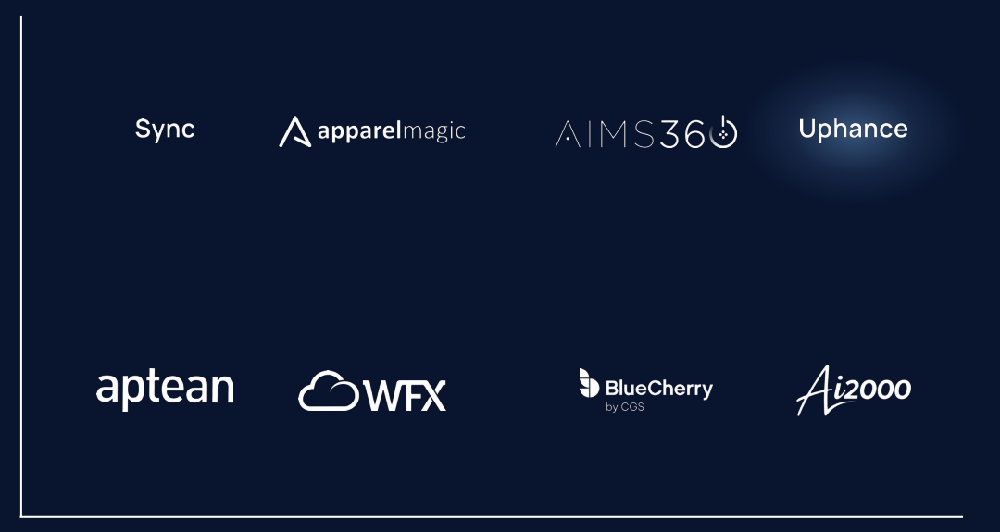

# Report — Agent 4: print-grade logos

Branch `agent/4-logos`, merged into `main`. Fixes P10 and D9–D11.

## What changed
- **Native resolution** (`logos.py`). `LogoMetrics.native_w` / `native_h` hold the trimmed logo's size in
  *source* pixels: the processed size divided by the upscale factor. They are `None` for SVG and typeset
  logos. `logo_metrics.json` records them for every candidate, alternative and chosen logo.
- **`checks/logo_print.py`** (registered in Layer A; fix `swap_logo`, field `logo:<name>`):
  - `print_dpi_issues(manifest, logo_metrics)` → `logo_low_res`: dpi = native px / printed in. The cover needs
    ≥ 300, the map ≥ 200; vector and typeset logos are exempt.
  - `tagline_issues` → `logo_tagline_microtext`, at each logo's smallest placement.
- **Tagline micro-text** (`logos.ink_bands`, `tagline_band`, `tagline_pt`, `crop_tagline`;
  `logo_sources.tagline_issue`):
  - Detection: row projection of the alpha channel; gaps under 1.5% of the height don't split a band. A lower
    band under 22% of the ink height is a tagline, and its printed height in points is
    share × printed height × 72.
  - Fix, for exactly 2 bands: crop + re-trim. If the bands touch or there are 3+ bands, it is not croppable
    and goes to `swap_logo`.
  - When sourcing: a candidate whose tagline would print under 5pt *on the map* goes to the same vision call
    a second time, cropped (id suffix `t`). No extra call.
  - In the QA loop, for Agent 6: `logo_sources.crop_logo(ctx, name, lg, out_dir)` crops, checks the crop with
    one cached vision call, and updates the logo entry.
  - `LogoVerdict.tagline_present` (default false) and `logo_check.md` ask the model as a hint only; the band
    test decides.
- **Ranking in `resolve_company`**: among accepted candidates, (1) no micro-text tagline at map size, (2) SVG,
  (3) highest native resolution, (4) source order.
  - If the winner is a raster under its print need (target: 300 dpi on the cover; competitors: 200 dpi on the
    map), its `@2x` / `-2x` / `_2x` sibling URLs are tried with direct GETs and used when the aspect matches.
  - The largest `srcset` entry and header inline SVGs were already gathered.
- **Short typeset names** (`names.brand_short_name`), used by every typeset fallback:
  - brackets, legal suffixes and generic suffixes are stripped while a distinctive root remains;
  - internal capitals and digits are kept;
  - an alias is used only when it is shorter and shares the name's first word.

  Typeset text stays ≥ 0.12 in tall on the map: one line up to 8.33:1 (1.0 in / 0.12 in), otherwise 2 balanced
  lines with `typeset_h` = 0.26 in, so each line keeps ≥ 0.12 in.

## Tests
`pytest -q`: **196 passed, 3 xfailed** (only D12, Agent 5's, remains). D9, D10 and D11 pass, with markers removed.
New `tests/test_print_logos.py` (25 tests):
- `test_native_px_recorded`
- the dpi rules, including the target-cover policy
- `test_crop_tagline` (AIMS360: no lower band left; aspect 4.37:1 → 5.65:1)
- three bands are not cropped
- `test_short_names` (15 cases)
- aliases and 2-line typeset height
- `test_svg_preferred`
- highest native resolution and the `@2x` sibling
- the crop variant winning in the same vision call
- `crop_logo` refusing a crop the vision check doesn't read as the logo
- the registered check on the Uphance run

## Before and after (Uphance, built offline from the fixture files, rendered by LibreOffice)
| | Before (live run) | After |
|---|---|---|
| Cover |  |  |
| Map |  |  |

- **Cover:** the 219 × 41 px source printed 2.07 in wide (≈ 106 dpi). Its only accepted alternative is the same
  file, so it falls back to the typeset short name. A live run first tries `@2x` siblings, which may find a
  sharp file.
- **Map:**
  - AIMS360's "FASHION TECHNOLOGY" line (1.7 pt) is cropped.
  - "Sync (iSync Solutions)" becomes "Sync", one line.
  - The target logo changes with the cover, because one file serves both slides.

What the new checks say about the three runs:
- **Uphance:** `logo_low_res` on the Uphance cover (106 dpi, error) and `logo_tagline_microtext` on AIMS360.
- **FDM4:** its own lockup has a 3.2 pt "ERP WMS ECOM DECO" line on the map. The site's clean "FDM4" header
  wordmark (also accepted in the live run) now ranks first, and AIMS360 and Acumatica get crop variants.
- **Ai2000:** its cover logo is 338 source pixels over 1.32 in, about **256 dpi**. That is a warning (see below);
  the briefs estimated 343 dpi.

## Decisions (docs/DECISIONS.md, "Phase 4")
- **The target's own cover logo between 200 and 300 dpi is a warning, not a swap.** The brief's chain would
  replace Ai2000's real logo with typeset type on the cover of the letter to Ai2000's founder. Keeping the
  real, slightly soft logo changes the deck less; below 200 dpi (Uphance) the brief's rule applies. Set
  `RECUR_TARGET_COVER_MIN_DPI=300` to apply 300 to the target's cover too.
- Native size = trimmed ink size in source pixels, not the file's canvas size.
- Taglines are judged at the logo's smallest placement (the map); a crop applies to every placement of that logo.

## Open risks
- Touching bands (InStyle's "In-Style Software" caption) can't be split by row projection, so they are not
  detected. The critic is the backstop.
- The target uses one logo file for the cover and the map (`build.py` is verified core), so a cover swap also
  changes the map.

## Requests for Agent 6
- Route `logo_tagline_microtext`: try `logo_sources.crop_logo` first, then the next alternative, then
  `typeset` (short name).
- Route `logo_low_res`: the next alternative with a higher `native_w` (or vector), then typeset. A warning
  severity needs no fix.
- Pass the full logo metrics as `extra["logos"]`, which `QAState.check_extra()` already does.
